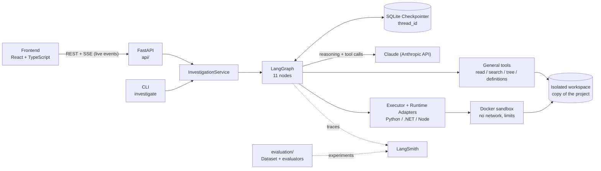
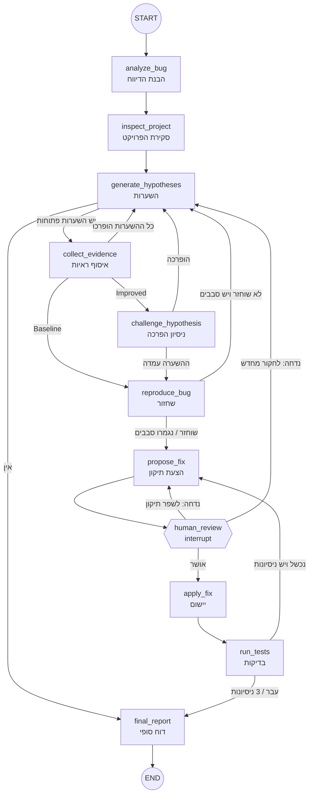
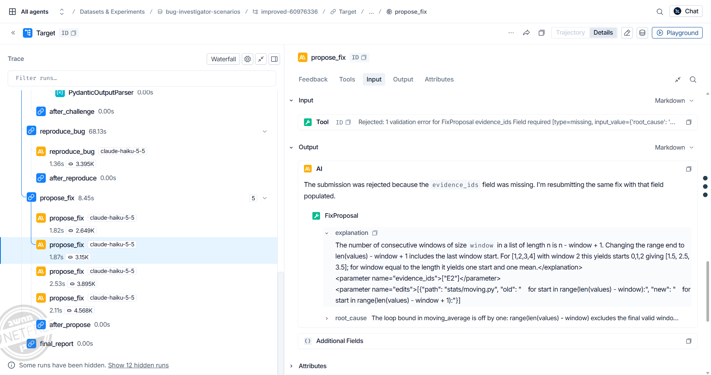
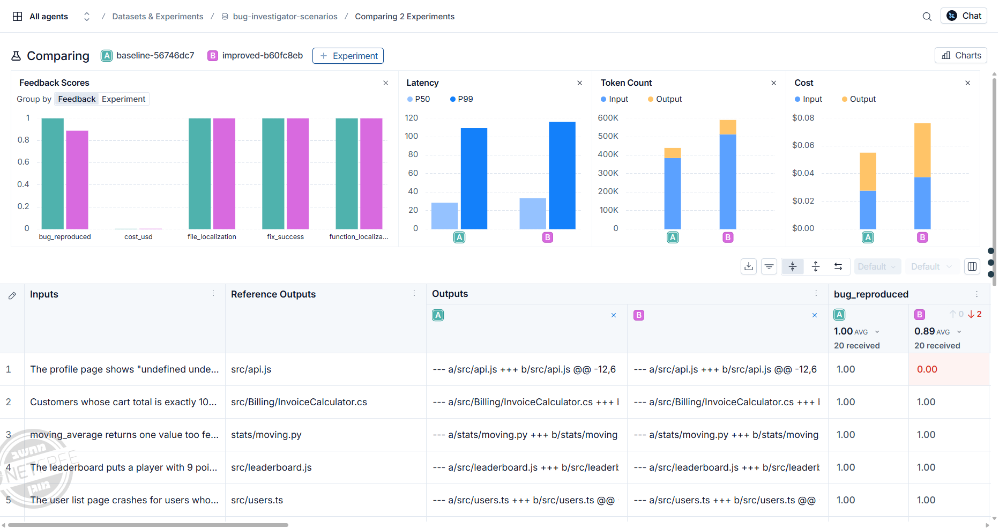
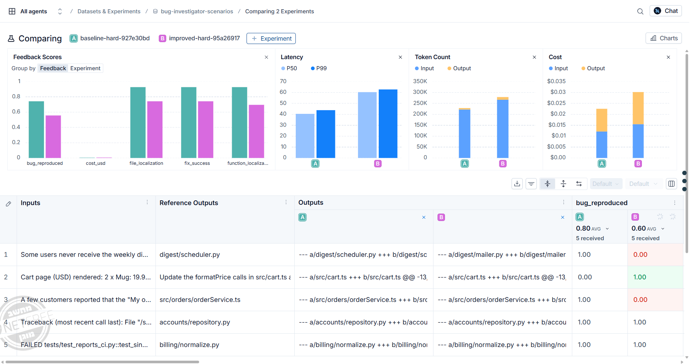
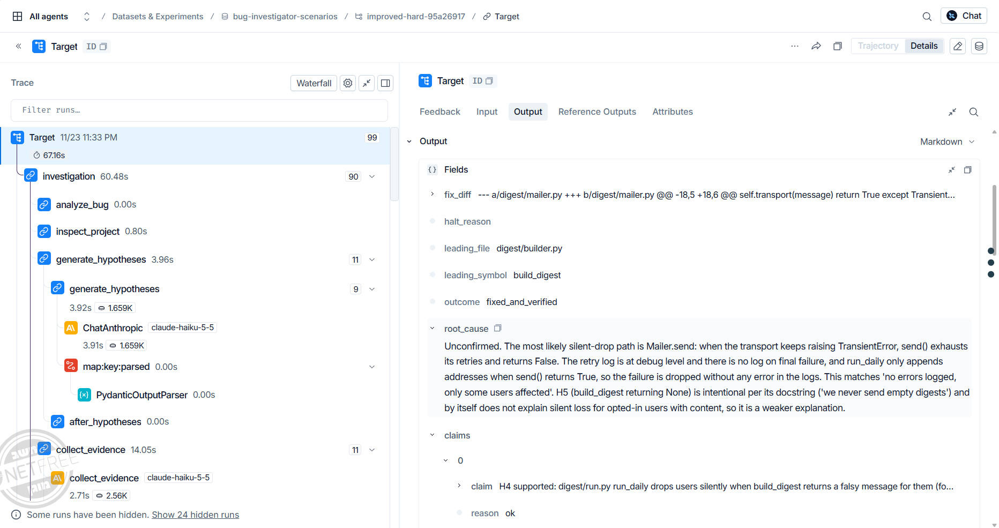
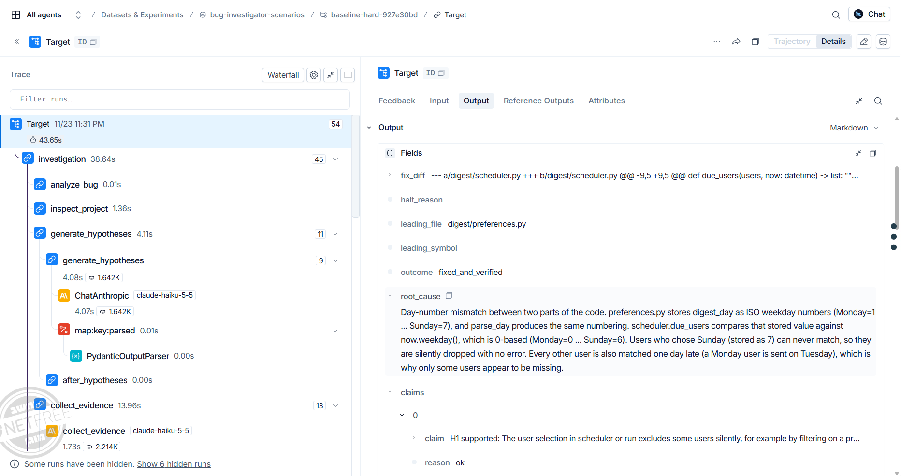

# Universal AI Bug Investigator

סוכן AI שחוקר באגים בפרויקטי תוכנה כמו מהנדס מנוסה. הוא מבין את הדיווח, סורק את הפרויקט ומעלה השערות, ואוסף ראיות מהקוד.
אחר כך הוא משחזר את הבאג בסביבת Docker מבודדת ומציע תיקון, ו**עוצר לאישור אנושי** לפני כל שינוי בקוד.
בסוף הוא מריץ בדיקות ומפיק דוח שמפריד בין עובדות מאומתות להשערות.

בנוי על **LangGraph** (גרף החקירה, `interrupt()` ו-Checkpointer) ועל **LangSmith** (Traces, Dataset והערכה אוטומטית).
ה-Backend כתוב ב-Python ו-FastAPI, וה-Frontend ב-React ו-TypeScript.

> **עיקרון מרכזי:** ה-LLM הוא מנוע החשיבה. אין מנתח קוד ייעודי לאף שפה. המערכת נותנת למודל כלים כלליים (קריאה, חיפוש, הרצה),
> והוא מחליט בעצמו איך לחקור. לכן אותו מנגנון עובד גם על Python, C# ו-TypeScript וגם על Go ו-Java.

---

## תוכן עניינים

1. [עמידה בדרישות התרגיל](#1-עמידה-בדרישות-התרגיל)
2. [ארכיטקטורה](#2-ארכיטקטורה)
3. [גרף ה-LangGraph](#3-גרף-ה-langgraph)
4. [הכלים שה-LLM מפעיל](#4-הכלים-שה-llm-מפעיל)
5. [תמיכה בריבוי שפות](#5-תמיכה-בריבוי-שפות)
6. [Human in the Loop](#6-human-in-the-loop)
7. [אבטחה ובידוד](#7-אבטחה-ובידוד)
8. [ממשק המשתמש](#8-ממשק-המשתמש)
9. [התקנה והרצה](#9-התקנה-והרצה)
10. [הגדרת LangSmith](#10-הגדרת-langsmith)
11. [ה-Dataset והמדדים](#11-ה-dataset-והמדדים)
12. [תוצאות: Baseline מול Improved](#12-תוצאות-baseline-מול-improved)
13. [צילומי Traces מ-LangSmith](#13-צילומי-traces-מ-langsmith)
14. [התובנה מה-Traces](#14-התובנה-מה-traces)
15. [מגבלות ידועות](#15-מגבלות-ידועות)

---

## 1. עמידה בדרישות התרגיל

| דרישת חובה | איפה זה בפרויקט |
|---|---|
| שימוש בספריית `langgraph` | `backend/src/investigator/graph/`: גרף של 11 צמתים עם `StateGraph` |
| גרף עם לולאה או ענף מותנה | שלוש לולאות אמיתיות ו-Conditional Edges אחרי כל צומת החלטה (סעיף 3) |
| `interrupt` ו-Human-in-the-loop | `graph/nodes/fix.py`: `interrupt()` אמיתי והמשך עם `Command(resume=...)` (סעיף 6) |
| Dataset והערכה אוטומטית ב-LangSmith, עם ניסוי לפני ואחרי | `evaluation/`: 25 תרחישים ו-8 מדדים, ניסויי Baseline ו-Improved בפועל (סעיפים 11–12) |
| README עם צילומי Trace ותובנה | סעיפים 13–14 וצילומים אמיתיים ב-`docs/screenshots/` |

---

## 2. ארכיטקטורה



**זרימת נתונים:**
1. המשתמש מעלה פרויקט (דוגמה מובנית, ZIP או GitHub ציבורי) ותיאור באג.
2. נוצרת **סביבת עבודה מבודדת**: עותק של הפרויקט, בלי קבצים רגישים.
3. הגרף רץ ברקע. כל צומת שמסתיים נכתב לאירוע, והממשק מקבל את האירועים בזמן אמת (Server-Sent Events).
4. כל קריאה לכלי נרשמת כ**ראיה** (`E1`, `E2`, …). המודל יכול רק לצטט ראיות קיימות, לא להמציא אותן.
5. ה-State נשמר ב-Checkpointer אחרי כל צומת, כך שאפשר לעצור (interrupt) ולהמשיך גם אחרי הפעלה מחדש של השרת.

**מבנה התיקיות:**

```
backend/src/investigator/
  graph/          state.py (ה-State), builder.py (הגרף), routing.py (כל ההחלטות), nodes/ (הצמתים)
  tools/          כלים כלליים ל-LLM + רישום ראיות
  runtimes/       Runtime Adapters (Python / .NET / Node): נתונים בלבד, בלי לוגיקת חקירה
  sandbox/        Docker runner, סביבת עבודה מבודדת, מדיניות אבטחה, קליטת פרויקטים
  api/            FastAPI: נקודות קצה, ריצות ברקע, אירועים חיים
  prompts/        הנחיות לכל שלב (Markdown)
  budget.py       מעקב עלויות ומגבלת תקציב
backend/tests/    126 בדיקות (119 מהירות + 7 עם Docker אמיתי)
frontend/         React + TypeScript + Vite
evaluation/       תרחישים, Dataset, מדדים, הרצת ניסויים, תוצאות
sandbox-images/   Dockerfile אחד לכל סביבות ההרצה
docs/             סיכומים, תובנות וצילומי Traces
```

---

## 3. גרף ה-LangGraph



**הלולאות האמיתיות:**
- **שחזור נכשל, חוזרים להשערות:** אם הבאג לא שוחזר, חוזרים לבחון השערות אחרות. מוגבל ל-2 סבבי השערות.
- **בדיקות נכשלו, חוזרים לתיקון:** אם התיקון לא עבר את הבדיקות, חוזרים ל-`propose_fix`. **מוגבל ל-3 ניסיונות תיקון.**
- **דחייה אנושית:** חוזרים לשיפור התיקון או לחקירה מחדש, לפי בחירת המשתמש.

**הצמתים:**

| צומת | מה הוא עושה | משתמש ב-LLM? |
|---|---|---|
| `analyze_bug` | מחלץ מהדיווח קבצים שהוזכרו ושגיאות | לא |
| `inspect_project` | מבנה הפרויקט, סוגי קבצים, זיהוי סביבת הרצה ורמת התמיכה | לא |
| `generate_hypotheses` | מזהה שפה, מסכם את הבאג ומציע השערות, כל אחת עם קובץ ופונקציה | כן |
| `collect_evidence` | חוקר עם הכלים ומכריע לכל השערה (נתמכת / הופרכה / לא חד-משמעית) עם ציטוט ראיות | כן, עם כלים |
| `challenge_hypothesis` | ב-Improved בלבד: מבקר שמנסה להפריך את ההשערה המובילה | כן |
| `reproduce_bug` | מריץ בדיקות או כותב סקריפט שחזור בארגז החול | כן, עם כלים |
| `propose_fix` | תיקון מדויק (טקסט ישן ← חדש) שמבוסס על ראיות, ומוצג כ-Diff | כן |
| `human_review` | `interrupt()`: עוצר וממתין לאדם | לא |
| `apply_fix` | כותב את השינוי לסביבת העבודה המבודדת בלבד | לא |
| `run_tests` | מריץ שוב את השחזור והבדיקות אחרי התיקון | לא |
| `final_report` | דוח שנבנה **בקוד** מתוך ה-State, בלי קריאה ל-LLM, ולכן בלי טענות חדשות | לא |

כל ההחלטות "לאן ממשיכים" נמצאות בקובץ אחד, `graph/routing.py`. הן פונקציות טהורות של ה-State, ולכן נבדקות בבדיקות יחידה בלי מודל.
אם צומת נתקל בעצירה קשיחה (תקציב, תשובה לא תקינה של המודל), החקירה מסתיימת בדוח חלקי ולא קורסת.

---

## 4. הכלים שה-LLM מפעיל

אף כלי לא "מבין" שפת תכנות. הם קוראים, מחפשים ומריצים, וההבנה מגיעה מהמודל. כל תוצאה של כלי נשמרת כראיה ממוספרת.

| כלי | מה הוא עושה |
|---|---|
| `list_tree` | מבנה התיקיות של הפרויקט או של תת-תיקייה |
| `read_file` | קריאת טווח שורות עם מספרי שורות |
| `search_code` | חיפוש מחרוזת או ביטוי רגולרי בכל הקבצים |
| `find_definitions` | איתור הגדרה של פונקציה, מחלקה או משתנה בכל שפה, לפי תבניות טקסט כלליות (לא Parser) |
| `run_tests` | הרצת חבילת הבדיקות של הפרויקט בארגז החול |
| `run_command` | הרצת תוכנית אחת **מרשימה מותרת** (בלי Shell ובלי רשת), למשל `["python", "repro.py"]` |
| `write_repro_file` | כתיבת סקריפט או בדיקת שחזור לתיקייה פרטית של הסוכן |
| הצעת תיקון → Diff | המודל מגיש `FixProposal` עם שינויים מדויקים. המערכת מחשבת Diff בלי לכתוב לדיסק, והשינוי נכתב רק אחרי אישור |

**הצעה לעומת יישום:** המודל אף פעם לא כותב ישירות לקוד הפרויקט. הוא מציע, האדם מאשר, וצומת נפרד (`apply_fix`) מיישם.

---

## 5. תמיכה בריבוי שפות

המערכת מפרידה בין **ניתוח** שפה לבין **הרצה** שלה, ומדווחת ביושר על רמת התמיכה:

| רמה | משמעות | שפות |
|---|---|---|
| `ANALYZE` | ה-LLM קורא ומבין את הקוד | כל שפה |
| `EDIT` | אפשר להציע ולהחיל תיקון | כל שפה מבוססת טקסט |
| `RUN` / `VERIFY` | בנייה, הרצת בדיקות ואימות התיקון | Python (pytest), C# (dotnet test), JavaScript/TypeScript (npm) |

- **Runtime Adapter** הוא נתונים בלבד: תמונת בסיס, פקודת התקנה, פקודת בדיקות ורשימת תוכנות מותרות (`runtimes/adapters.py`).
  כדי להוסיף שפה להרצה (למשל Java) מוסיפים Adapter אחד ובונים מחדש את התמונה, **בלי לשנות את הגרף**.
- **שפה שאינה נתמכת בהרצה** (למשל Go או Java): הסוכן עדיין מנתח ומציע תיקון, אבל מסביר שאין אפשרות להריץ בדיקות,
  והתוצאה היא `fixed_unverified`, לא "מאומת". ב-Dataset יש תרחישי Go ו-Java שבודקים בדיוק את זה.

---

## 6. Human in the Loop

זהו **`interrupt()` אמיתי של LangGraph**, לא כפתור אישור בממשק:

1. `propose_fix` מכין תיקון. `human_review` קורא ל-`interrupt()` עם שורש הבעיה, ההסבר, ה-Diff והראיות.
2. LangGraph **שומר את ה-State ב-Checkpointer (SQLite) תחת `thread_id` ייחודי ועוצר**. התהליך יכול לחכות שעות, וגם לשרוד הפעלה מחדש של השרת.
3. המשתמש מאשר או דוחה (בממשק, ב-CLI או דרך ה-API).
4. ההמשך נעשה עם **`Command(resume={...})`** על אותו `thread_id`, והערך חוזר מתוך `interrupt()`.
5. **דחייה:** המשתמש בוחר "לשפר את התיקון" או "לחקור סיבות אחרות". אם דחה **בלי נימוק**, הגרף עוצר **שוב** עם `interrupt()` שני ושואל למה.
6. התשובה נבדקת מול סוג העצירה **לפני** שממשיכים. תשובה לא מתאימה נדחית, ושום דבר לא רץ.

בנוסף אפשר **לבטל** חקירה בכל שלב. אם מבטלים בזמן התקנה או בדיקות, הקונטיינר נהרג מיד, ושום שינוי לא נכתב.

---

## 7. אבטחה ובידוד

הקוד של הפרויקט נחשב **לא אמין**:

| מנגנון | מימוש |
|---|---|
| הרצה רק ב-Docker | כל התקנה ובדיקה רצה בקונטיינר חד-פעמי (`--rm`) |
| בלי רשת כברירת מחדל | `--network none` לכל הרצה. הרשת נפתחת **רק** לפקודת ההתקנה הקבועה של ה-Adapter, שה-LLM לא יכול לשנות |
| מגבלות משאבים | זיכרון (2GB), CPU (2), מספר תהליכים (512), זמן ריצה (180 שניות) |
| הקשחת קונטיינר | `--read-only`, `--cap-drop ALL`, `no-new-privileges`, משתמש לא מורשה (10001) |
| בלי קבצים רגישים | `.env`, מפתחות, תעודות ו-`credentials` לעולם לא מועתקים לסביבת העבודה, כך שהמודל לא יכול לקרוא אותם |
| בלי פקודות שרירותיות | `run_command` מקבל רק תוכניות מרשימה מותרת לכל שפה, בלי Shell |
| בלי סקריפטי התקנה | `npm ci --ignore-scripts`, ו-pip מתקין חבילות בינאריות בלבד |
| הפרדה בין הצעה ליישום | השינוי נכתב רק אחרי אישור, ורק לעותק המבודד, **לעולם לא לפרויקט המקורי** |
| הגנה על נתיבים | אי אפשר לקרוא או לכתוב מחוץ לסביבת העבודה; ZIP מוגן מ-zip-slip |
| בקרת עלויות | מגבלה חודשית ($15) ומגבלת טוקנים לכל חקירה |
| מפתחות | רק במשתני סביבה (`.env`, שלא נכנס ל-git) |

---

## 8. ממשק המשתמש

React ו-TypeScript, בעיצוב כהה ומודרני:

- **Home:** איור מונפש, גרף תוצאות החקירות, פעילות לאורך זמן ופילוח לפי שפות.
- **Overview:** כל החקירות, תקציב חודשי והתראה על תיקונים שמחכים לאישור.
- **New investigation:** בחירת דוגמה מובנית, העלאת ZIP או קישור GitHub, תיאור הבאג, ושני מצבים: **Thorough** (Improved) או **Fast** (Baseline).
- **מסך החקירה:**
  - שרטוט חי של הגרף: איפה החקירה נמצאת ואילו לולאות עברה;
  - התקדמות חיה של התקנות ובדיקות עם טיימר, וכפתור ביטול;
  - לשוניות של השערות, ראיות, בדיקות, התיקון כ-Diff ומבנה הפרויקט, וצפייה בקבצים;
  - פאנל אישור או דחייה;
  - **דוח סופי** שמפריד בבירור בין *Verified facts* (כל עובדה עם מספרי הראיות שלה) לבין *Unverified*.
- **Evaluation:** תוצאות הניסויים האמיתיים מ-LangSmith.

---

## 9. התקנה והרצה

**דרישות מקדימות:** Python 3.12 ומעלה, Node.js 22, Docker Desktop, ומפתח API של Anthropic.

```bash
# 1. הגדרות: העתיקי את .env.example ל-.env ומלאי ANTHROPIC_API_KEY
copy .env.example .env

# 2. Backend
cd backend
python -m venv .venv
.venv\Scripts\pip install -e ".[dev]"

# 3. תמונות ארגז החול (פעם אחת, כמה דקות)
.venv\Scripts\python -m investigator.sandbox.images

# 4. הפעלת ה-API (פורט 8000)
.venv\Scripts\python -m uvicorn investigator.api.app:app --port 8000
```

```bash
# 5. Frontend (בחלון נוסף)
cd frontend
npm install
npm run dev
# http://localhost:5173
```

**הרצה מהטרמינל (בלי ממשק):**
```bash
cd backend
.venv\Scripts\investigate --path ..\evaluation\scenarios\py-off-by-one\project --bug "moving_average returns one value too few"
```

**בדיקות:**
```bash
cd backend
.venv\Scripts\python -m pytest -q -m "not docker"   # 119 בדיקות מהירות, בלי מודל ובלי עלות
.venv\Scripts\python -m pytest -q -m docker         # 7 בדיקות עם Docker אמיתי
```

> **מאחורי סינון HTTPS (כמו NetFree):** ה-Backend משתמש במאגר התעודות של Windows (`USE_SYSTEM_TRUST_STORE=true`),
> ובניית התמונות מעתיקה אליהן את תעודות השורש של המחשב. ל-npm: `set NODE_OPTIONS=--use-system-ca` לפני `npm install`.

---

## 10. הגדרת LangSmith

1. פותחים חשבון ב-[smith.langchain.com](https://smith.langchain.com) ויוצרים API Key.
2. ב-`.env`:
   ```
   LANGSMITH_TRACING=true
   LANGSMITH_API_KEY=<המפתח שלך>
   LANGSMITH_PROJECT=bug-investigator
   ```
3. מעכשיו כל חקירה נשמרת כ-Trace מלא: כל צומת, כל קריאה למודל וכל כלי.
4. הרצת ההערכה (מתיקיית השורש):
   ```bash
   backend\.venv\Scripts\python evaluation\validate_scenarios.py             # בדיקת התרחישים, בלי LLM
   backend\.venv\Scripts\python evaluation\create_dataset.py                 # יצירת ה-Dataset ב-LangSmith
   backend\.venv\Scripts\python evaluation\run_experiment.py --mode baseline
   backend\.venv\Scripts\python evaluation\run_experiment.py --mode improved
   backend\.venv\Scripts\python evaluation\compare_results.py <baseline.json> <improved.json> comparison.md
   ```
   `--difficulty hard` מריץ רק את התרחישים הקשים. `create_dataset.py --append` מוסיף תרחישים חדשים בלי למחוק את היסטוריית הניסויים.

---

## 11. ה-Dataset והמדדים

**Dataset:** `bug-investigator-scenarios` ב-LangSmith, עם **25 תרחישים אמיתיים**: 20 בסיסיים ו-5 קשים.

| שפה | תרחישים |
|---|---|
| Python | 11 |
| C# | 5 |
| TypeScript | 5 |
| JavaScript | 2 |
| Go, Java (לא נתמכות בהרצה: בודקות כנות) | 1 + 1 |

**סוגי באגים:** Null Reference, שגיאות לוגיות, Off-by-one, לולאות אינסופיות, שגיאות API, בעיות תלויות, טיפול שגוי בחריגות, Race Conditions, SQL Injection ו-Regression.

**כל תרחיש** (`evaluation/scenarios/<id>/`) כולל:
- `project/`: הפרויקט עם הבאג (הקלט).
- `scenario.yaml`: תיאור הבאג, הודעת שגיאה, ו**התוצאה הצפויה** (קובץ, פונקציה, סיבת שורש, התיקון הרצוי).
- `hidden/`: **בדיקות נסתרות** שהסוכן אף פעם לא רואה. הן מוכנסות רק אחרי החקירה, כדי לבדוק שהתיקון באמת עובד.
- תיקון ייחוס: `validate_scenarios.py` מוודא שהבדיקות נכשלות על הבאג ועוברות אחרי תיקון הייחוס.

**התרחישים הקשים** מוסיפים קושי אמיתי:
- סיבה רחוקה מהסימפטום;
- דיווח בלי שום הודעת שגיאה;
- תיקון שחייב לגעת בשני קבצים;
- stack trace ו-CHANGELOG שמטעים;
- פרויקט של 13 קבצים עם קוד חשוד.

בכולם הבדיקות הגלויות **עוברות** על הקוד השבור, כך שהסוכן חייב לשחזר את הבאג בעצמו.

**המדדים** (`evaluation/evaluators.py`):

| מדד | איך נמדד |
|---|---|
| איתור הקובץ / הפונקציה | השוואה למיקום הצפוי |
| דיוק סיבת השורש | שופט LLM מול הסיבה הצפויה |
| שחזור הבאג | האם הסוכן הראה הרצה שבה הבאג קורה |
| הבדיקות של הסוכן עוברות אחרי התיקון | תוצאת `run_tests` |
| **התיקון עובר את הבדיקות הנסתרות** | המדד החשוב ביותר: הבדיקות שהסוכן לא ראה |
| שיעור טענות לא מבוססות | ביקורת אוטומטית: האם כל טענה בדוח מצטטת ראיה רלוונטית |
| עלות לחקירה | מתוך יומן השימוש |

---

## 12. תוצאות: Baseline מול Improved

**Baseline:** השערות, ראיות, שחזור ותיקון.
**Improved:** מוסיף **שלב ביקורתי** (`challenge_hypothesis`) שמנסה להפריך את ההשערה המובילה, ומחייב ציטוט ראיה לכל טענה.
כל המספרים כאן מהרצות אמיתיות (מודל `claude-haiku-5-5` ו-Docker אמיתי). הקבצים המקוריים נמצאים ב-`evaluation/results/`.

### 20 התרחישים הבסיסיים: שלושה סבבים

כל סבב נבע מניתוח ה-Traces של הסבב הקודם (פירוט בסעיף 14):

| סבב | שינוי | תיקון עובר בדיקות נסתרות (Baseline / Improved) |
|---|---|---|
| 1 | — | 89% / 72% |
| 2 | `strict=True` בקריאות הכלים | 94% / 78% |
| 3 (סופי) | שדה השינויים ראשון בטופס, וחובה לפחות שינוי אחד | **100% / 100%** |

**הסבב הסופי (`baseline-56746dc7` מול `improved-b60fc8eb`):**

| מדד | Baseline | Improved |
|---|---|---|
| איתור הקובץ | 100% | 100% |
| איתור הפונקציה | 100% | 100% |
| סיבת שורש (שופט LLM) | 100% | 98% |
| שחזור הבאג | 100% | 89% |
| הבדיקות של הסוכן עוברות | 100% | 100% |
| **תיקון עובר בדיקות נסתרות** | **100%** | **100%** |
| טענות לא מבוססות | 0% | 0% |
| עלות לחקירה | $0.0025 | $0.0035 |

### 5 התרחישים הקשים (`baseline-hard-927e30bd` מול `improved-hard-95a26917`)

| מדד | Baseline | Improved |
|---|---|---|
| איתור הקובץ | 100% | 80% |
| איתור הפונקציה | 100% | 75% |
| סיבת שורש (שופט LLM) | 100% | 80% |
| שחזור הבאג | 80% | 60% |
| **תיקון עובר בדיקות נסתרות** | **100%** | **80%** |
| טענות לא מבוססות | 0% | 5% |
| עלות לחקירה | $0.0044 | $0.0060 |

**מסקנות כנות:**
1. **השלב הביקורתי לא שיפר את התוצאות.** בתרחישים הבסיסיים זה אפקט תקרה: Baseline כבר אבחן הכול נכון.
   בתרחישים הקשים Improved נכשל בתרחיש אחד, והוא יקר בכ-40%.
2. **זה לא מוכיח ש-Improved גרוע יותר.** היו 5 תרחישים והרצה אחת לכל מצב, כך שתרחיש אחד שווה 20%.
   המסקנה הזהירה: **לא מצאנו ראיה שהשלב הביקורתי עוזר**.
3. **השיפור האמיתי והמדוד הגיע מניתוח ה-Traces:** מ-72% ל-100% (סעיף 14).

עלות כל ניסויי ההערכה יחד: פחות מ-$0.55.

---

## 13. צילומי Traces מ-LangSmith

כל הצילומים אמיתיים, מתוך חשבון ה-LangSmith של הפרויקט.

**סבב 1, טופס התיקון השבור.** המערכת דוחה את ההגשה ("Field required"), והמודל כותב שהוא שולח שוב. בפועל השדות `edits` ו-`evidence_ids` נכנסו כתגיות XML **בתוך** טקסט ההסבר:



**ההשוואה הסופית על 20 התרחישים:**



**התרחישים הקשים.** בשורה 1 Baseline תיקן את `scheduler.py` (הבאג האמיתי), ו-Improved תיקן את `mailer.py` (המסיח):



**Improved הוסח.** סיבת השורש "Unconfirmed", ובכל זאת התוצאה הייתה `fixed_and_verified`:



**Baseline באותו תרחיש.** זיהה נכון את ההבדל בין `weekday()` לימים בתקן ISO:



---

## 14. התובנה מה-Traces

### "האבחון היה נכון. טופס התיקון היה שבור."

בניסוי הראשון נראה שיש בעיית חשיבה: רק 72% מהתיקונים של Improved עברו את הבדיקות הנסתרות.
אבל המדדים הראו ש**האבחון היה מושלם**: 100% קובץ נכון, 100% פונקציה נכונה ו-100% סיבת שורש נכונה.
כל הכישלונות קרו בשלב אחד, `propose_fix`.

ה-Traces הראו למה: **ב-42 מתוך 44 הגשות, קריאת הכלי עצמה הייתה שבורה.** היו בה שדות חסרים, רשימה שנשלחה כטקסט,
ושדות שלמים שנכתבו בתוך שדה אחר (צילום 1). המודל ידע מה לתקן, אבל לא הצליח למלא את הטופס.

**שני תיקונים קטנים במבנה הכלי, בלי לגעת בהנחיות החשיבה:**
1. `strict=True`: ה-API מבטיח שהקריאה תואמת את הסכמה. ה-Traces של הסבב הבא הראו משהו מפתיע:
   כל 37 ההגשות שנדחו הגיעו עם רשימת שינויים **ריקה** (`edits: []`).
   **`strict` מבטיח את המבנה, לא את התוכן.**
2. העברת `edits` לראש הטופס (לפני ההסברים הארוכים), ודרישה לפחות לשינוי אחד.

**התוצאה:** מ-72% ל-**100%** ב-Improved, ומ-89% ל-**100%** ב-Baseline.

**תובנה נוספת, מהתרחישים הקשים:** ב-`py-hard-weekly-digest` הסוכן קרא את הקובץ הנכון פעמיים, אבל הלך אחרי מסיח.
הוא כתב שסיבת השורש **"Unconfirmed"**, ובכל זאת דיווח **"verified"** (צילומים 4–5), כי הבדיקות שלו עברו, אף שלא בדקו את הבאג.
**בעקבות זאת שינינו את הקוד:** הדוח לא מאפשר יותר `fixed_and_verified` בלי שחזור של הבאג.
השינוי בוצע אחרי המדידה (המספרים למעלה נמדדו לפניו), ויש לו בדיקת יחידה.

> הניתוח המלא: [`docs/evaluation-insights.md`](docs/evaluation-insights.md) · סיכום שלב ההערכה: [`docs/stage-e-summary.md`](docs/stage-e-summary.md)

---

## 15. מגבלות ידועות

- **Dataset קטן:** 25 תרחישים, הרצה אחת לכל מצב. יש שונות בין הרצות.
- **סיכון של התאמת יתר:** תיקוני הטופס נמצאו על אותו Dataset שעליו מדדנו. הם כלליים (מבנה הכלי), ולכן הסיכון נמוך.
- **שופט LLM לא מושלם:** למשל, ציון 0.5 להסבר נכון ב-`ts-infinite-loop`.
- **פרויקטים גדולים איטיים:** התקנה של פרויקט Create React App, למשל, יכולה לקחת כמה דקות בארגז החול. הממשק מציג התקדמות חיה ומאפשר לבטל.
- **הרצה ואימות** נתמכים כרגע ב-Python, C# ו-JavaScript/TypeScript. שאר השפות מנותחות ומתוקנות, אבל מדווחות כ"לא מאומת".
